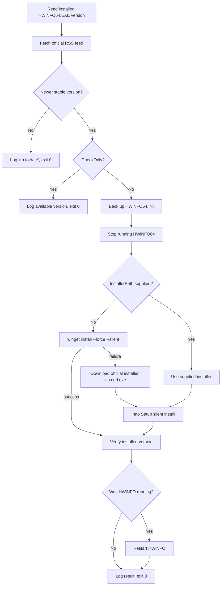

# HWiNFO Auto-Update

A small, dependency-free PowerShell toolkit that watches the **official HWiNFO release feed** and silently upgrades HWiNFO 64 to the latest **stable** version when one is published.

It was written for machines where HWiNFO was installed with the official Inno Setup installer and where winget is available. No third-party modules, no scheduled task editor, no background service — just two PowerShell scripts and one Windows scheduled task.

---

## Table of contents

- [Why this exists](#why-this-exists)
- [Features](#features)
- [How it works](#how-it-works)
- [Requirements](#requirements)
- [Installation](#installation)
- [Usage](#usage)
- [Scheduled task](#scheduled-task)
- [Script parameters](#script-parameters)
- [Files and paths](#files-and-paths)
- [Logging and backups](#logging-and-backups)
- [Exit codes](#exit-codes)
- [Troubleshooting](#troubleshooting)
- [Security considerations](#security-considerations)
- [Limitations](#limitations)
- [Contributing](#contributing)
- [License and third-party notices](#license-and-third-party-notices)

---

## Why this exists

HWiNFO's built-in automatic update capability is a Pro feature. On a free/installer-based deployment, keeping HWiNFO current normally means manually visiting the download page. This toolkit fills that gap by using the vendor's own public RSS news feed as the "new version available" signal, then performing the same silent install an administrator would do by hand.

It deliberately reacts to **stable** announcements only. Beta and release-candidate builds are published in the same feed but are ignored.

## Features

| Feature | Behavior |
| --- | --- |
| Official update signal | Parses `https://www.hwinfo.com/news.xml/`; selects `HWiNFO vX.YY released`, excludes `Beta`, `RC`, `pre-release`. |
| Local version detection | Reads `HWiNFO64.EXE` `ProductVersion` (e.g. `8.52-6060` → `8.52`); install directory is detected from the Windows uninstall registry, with a Program Files fallback and a `-InstallDir` override. |
| Settings preservation | Backs up `HWiNFO64.INI` with a timestamp before every upgrade. |
| Silent upgrade | Primary path: `winget install --exact --force --silent` (winget verifies the publisher SHA-256). Fallback: direct download of the official installer + `/VERYSILENT /SUPPRESSMSGBOXES /NORESTART`. |
| Verification | Re-reads the installed version after the installer exits and fails the run if it did not reach the announced version. |
| Process handling | Stops running `HWiNFO64` before the upgrade (Inno Setup cannot replace files in use) and restarts it afterwards if it was running. |
| Dry run | `-CheckOnly` reports the comparison and makes no changes. |
| Auditability | Every step is appended to a local log file. |

## How it works



## Requirements

- Windows 10 / Windows 11 (x64 or ARM64; the script targets `HWiNFO64.EXE`).
- Windows PowerShell 5.1 or newer (the scripts are compatible with PowerShell 7 as well).
- Administrator rights **at upgrade time** — the installer writes to `C:\Program Files\HWiNFO64`.
- Internet access to `www.hwinfo.com` (RSS, download page, installer) and, for the primary path, the Windows Package Manager source used by winget.
- `winget` (App Installer) is recommended but optional; without it the script falls back to the direct download path.
- `curl.exe` (built into Windows 10/11) is recommended for the fallback path.

## Installation

1. Clone or download this repository into a permanent folder, for example `C:\Users\<you>\Scripts\hwinfo-auto-update`.
   Keep the folder path stable — the scheduled task stores an absolute path to `Update-HWiNFO.ps1`.
2. Verify the two scripts are present in the same directory:
   ```powershell
   Get-ChildItem .\Update-HWiNFO.ps1, .\Bootstrap-HWiNFO-AutoUpdate.ps1
   ```
3. Run the one-time bootstrap from a normal PowerShell window and approve the UAC prompt:
   ```powershell
   powershell -NoProfile -ExecutionPolicy Bypass -File .\Bootstrap-HWiNFO-AutoUpdate.ps1
   ```

The bootstrap performs an immediate update check and registers the daily task. It is safe to re-run; `Register-ScheduledTask -Force` replaces an existing task with the same name.

## Usage

### 1. Check only (no changes)

```powershell
powershell -NoProfile -ExecutionPolicy Bypass -File .\Update-HWiNFO.ps1 -CheckOnly
```

Typical output:

```text
2026-11-25 23:35:34 [INFO] Installed version: 8.60
2026-11-25 23:35:34 [INFO] Latest stable version: 8.60 (source: https://www.hwinfo.com/news.xml/)
2026-11-25 23:35:35 [INFO] Already up to date.
```

### 2. Manual update

Run as administrator (or let the scheduled task run it):

```powershell
powershell -NoProfile -ExecutionPolicy Bypass -File .\Update-HWiNFO.ps1
```

### 3. Repair / reinstall the same version

```powershell
powershell -NoProfile -ExecutionPolicy Bypass -File .\Update-HWiNFO.ps1 -Force
```

### 4. Use a pre-downloaded installer

Useful on a machine with a slow or filtered winget source:

```powershell
powershell -NoProfile -ExecutionPolicy Bypass -File .\Update-HWiNFO.ps1 -InstallerPath 'C:\Temp\hwi64_860.exe'
```

The script still reads the RSS feed first: the supplied installer is only used if an update is actually needed (or `-Force` is given).

### 5. Change the schedule

```powershell
powershell -NoProfile -ExecutionPolicy Bypass -Command "& '.\Bootstrap-HWiNFO-AutoUpdate.ps1' -TaskName 'HWiNFO-AutoUpdate' -TaskTime '18:30'"
```

## Scheduled task

Created by `Bootstrap-HWiNFO-AutoUpdate.ps1`:

| Property | Value |
| --- | --- |
| Name | `HWiNFO-AutoUpdate` (configurable via `-TaskName`) |
| Trigger | Daily at `09:00` (configurable via `-TaskTime`) |
| Run level | Highest privileges |
| Principal | Current user, interactive logon |
| Action | `powershell.exe -NoProfile -ExecutionPolicy Bypass -NonInteractive -File "<repo>\Update-HWiNFO.ps1"` |
| Start when available | Yes — a missed 09:00 run is executed at next logon |
| Multiple instances | IgnoreNew |
| Execution time limit | 15 minutes |

Inspect or remove it with:

```powershell
Get-ScheduledTask -TaskName 'HWiNFO-AutoUpdate' | Format-List
Unregister-ScheduledTask -TaskName 'HWiNFO-AutoUpdate' -Confirm:$false
```

## Script parameters

### Update-HWiNFO.ps1

| Parameter | Type | Default | Description |
| --- | --- | --- | --- |
| `-CheckOnly` | switch | off | Compare versions and exit without modifying the system. |
| `-Force` | switch | off | Run the upgrade even if the installed version is equal or newer. |
| `-NoRestore` | switch | off | Do not restart HWiNFO after the upgrade. |
| `-InstallerPath` | string | none | Use a pre-downloaded installer instead of winget / network download. |
| `-InstallDir` | string | auto-detected | Override the HWiNFO installation directory. |
| `-LogPath` | string | `<script dir>\Update-HWiNFO.log` | Log file location. |

### Bootstrap-HWiNFO-AutoUpdate.ps1

| Parameter | Type | Default | Description |
| --- | --- | --- | --- |
| `-TaskName` | string | `HWiNFO-AutoUpdate` | Scheduled task name. |
| `-TaskTime` | string | `09:00` | Daily run time (`HH:mm`). |
| `-InstallerPath` | string | none | Passed through to `Update-HWiNFO.ps1`. |
| `-StalePids` | int[] | none | Process IDs of a previous stuck update to terminate before upgrading. |

Note: when passing an array from `powershell -Command`, use `-StalePids @(1234,5678)`; `-StalePids 1234,5678` is parsed as a single string by PowerShell's command-line binding.

## Files and paths

| Item | Location | Purpose |
| --- | --- | --- |
| `Update-HWiNFO.ps1` | repository root | Version check and upgrade logic. |
| `Bootstrap-HWiNFO-AutoUpdate.ps1` | repository root | Elevation + task registration. |
| `Update-HWiNFO.log` | repository root | Append-only run log. |
| `Bootstrap-HWiNFO-AutoUpdate.log` | repository root | One-time setup log. |
| `HWiNFO-Backups/` | repository root | Timestamped `HWiNFO64.INI` backups. |
| `%TEMP%\HWiNFO-AutoUpdate\` | user temp | Installers downloaded by the fallback path. |

`*.log`, `HWiNFO-Backups/` and `*.exe` are excluded via `.gitignore`.

## Logging and backups

Every run appends lines in the form:

```text
yyyy-MM-dd HH:mm:ss [LEVEL] message
```

Levels: `INFO`, `WARN`, `ERROR`. An update backs up `HWiNFO64.INI` as `HWiNFO64.<yyyyMMdd-HHmmss>.INI` before touching the installation. Keep or prune these backups according to your retention policy; the script never deletes them.

## Exit codes

| Code | Meaning |
| --- | --- |
| `0` | Up to date, dry-run comparison completed, or upgrade verified successfully. |
| `1` | Failure: version feed unreachable, install directory not found, download/install failed, or post-install verification failed. |

Scheduled Task Scheduler reports `0x41303` (`267011`, "task has not yet run") before the first execution — this is normal.

## Troubleshooting

| Symptom | Cause | Action |
| --- | --- | --- |
| `Cannot locate HWiNFO64.EXE` | Non-standard install directory or portable build. | Pass `-InstallDir "D:\Tools\HWiNFO64"`. |
| Official CDN returns `403` with `Invoke-WebRequest` | The vendor CDN rejects that client in some environments. | The script uses `curl.exe` with a browser User-Agent first; keep curl.exe available. |
| winget download stalls for several minutes | The winget manifest points to a slower mirror (`sac.sk`). | Wait, or cancel it and run with `-InstallerPath` using an installer downloaded from `https://www.hwinfo.com/download/`. |
| UAC prompt dismissed / elevation times out | The elevated bootstrap never started; no changes were made. | Re-run the bootstrap and approve the prompt. |
| `Access denied` on `Wait-Process` / `Stop-Process` | A non-elevated process cannot control an elevated one. | Perform the cleanup from the elevated bootstrap (`-StalePids`). |
| A new Beta appears but nothing is installed | By design — Beta / RC announcements are filtered out. | Wait for the stable announcement, or edit `Get-LatestStableVersion` if you intentionally want pre-releases. |
| HWiNFO window disappears briefly | The script stops it so Inno Setup can replace files, then restarts it. | Use `-NoRestore` if you prefer to restart it yourself. |
| First scheduled run shows `267011` | Task has not run yet. | Nothing to do; check after the first scheduled time. |

## Security considerations

- Version information comes only from the vendor's RSS feed; installers come from the vendor's download page or from the winget manifest that the vendor publishes.
- The winget path validates the installer hash against the publisher-provided SHA-256 before installation.
- The direct-download path **logs** the SHA-256 of the downloaded file but does not pin a known-good value. winget is therefore the preferred path; use `-InstallerPath` only with installers you obtained from `https://www.hwinfo.com/download/`.
- The scripts store no credentials, tokens, or personally identifiable configuration; they only read public HTTPS endpoints and local installation metadata.
- UAC elevation is requested explicitly by the bootstrap. Review the script before approving elevation on a new machine.

## Limitations

- Windows only; HWiNFO 32 / DOS editions are out of scope.
- Stable releases only; pre-releases are excluded by design.
- Requires administrator rights for the actual upgrade and for highest-privilege task registration.
- The official HWiNFO installer may launch HWiNFO once after installation; the script does not suppress that built-in post-install action.
- Version comparison uses `major.minor` only (e.g. `8.60`), matching the vendor's public release numbering; build numbers such as `6120` are not used for the comparison.
- If the vendor changes its RSS title format or installer URL convention, the parser in `Get-LatestStableVersion` / `Get-InstallerUrl` must be updated.

## Contributing

Issues and pull requests are welcome. When reporting a problem, include:

- Windows version and PowerShell version (`$PSVersionTable.PSVersion`).
- Installed HWiNFO version and install directory.
- The relevant lines from `Update-HWiNFO.log` (with any local paths redacted if needed).
- Whether winget was available and whether the failure occurred on the winget or fallback path.

Please do not open issues for HWiNFO application bugs — report those to the vendor.

## License and third-party notices

The scripts in this repository are released under the [MIT License](LICENSE).

HWiNFO® is a registered trademark of Martin Malík / REALiX, s.r.o. This project is an independent utility and is **not affiliated with, endorsed by, or sponsored by** REALiX. The HWiNFO software itself remains subject to the vendor's own license terms; see <https://www.hwinfo.com/licenses/>.
