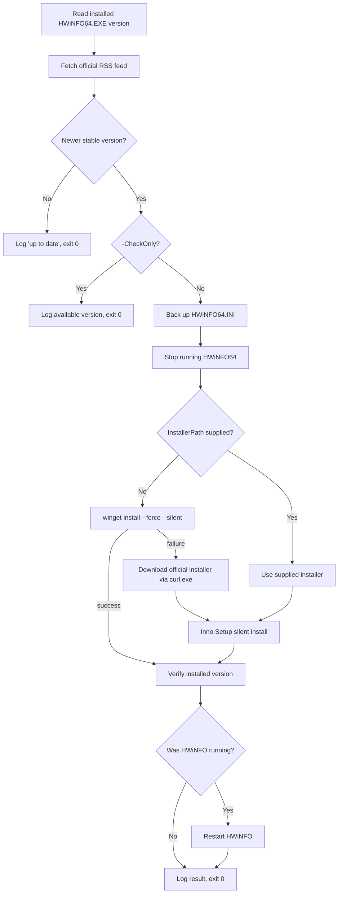

# HWiNFO Auto-Update

[](https://github.com/milochen0106/hwinfo-auto-update/actions/workflows/tests.yml)

> Languages: **English** | [繁體中文](README.zh-TW.md)

A small, dependency-free PowerShell toolkit that watches the **official HWiNFO release feed** and silently upgrades HWiNFO 64 to the latest **stable** version when one is published.

It was written for machines where HWiNFO was installed with the official Inno Setup installer and where winget is available. No third-party modules, no scheduled task editor, no background service — just two PowerShell scripts and one Windows scheduled task.

---

## Table of contents

- [Why this exists](#why-this-exists)
- [Features](#features)
- [How it works](#how-it-works)
- [Requirements](#requirements)
- [Installation](#installation)
- [Usage](#usage)
- [Scheduled task](#scheduled-task)
- [Script parameters](#script-parameters)
- [Files and paths](#files-and-paths)
- [Logging and backups](#logging-and-backups)
- [Exit codes](#exit-codes)
- [Development and tests](#development-and-tests)
- [Troubleshooting](#troubleshooting)
- [Security considerations](#security-considerations)
- [Limitations](#limitations)
- [Contributing](#contributing)
- [License and third-party notices](#license-and-third-party-notices)

---

## Why this exists

HWiNFO's built-in automatic update capability is a Pro feature. On a free/installer-based deployment, keeping HWiNFO current normally means manually visiting the download page. This toolkit fills that gap by using the vendor's own public RSS news feed as the "new version available" signal, then performing the same silent install an administrator would do by hand.

It deliberately reacts to **stable** announcements only. Beta and release-candidate builds are published in the same feed but are ignored.

## Features

| Feature | Behavior |
| --- | --- |
| Official update signal | Parses `https://www.hwinfo.com/news.xml/`; selects `HWiNFO vX.YY released`, excludes `Beta`, `RC`, `pre-release`. |
| Local version detection | Reads `HWiNFO64.EXE` `ProductVersion` (e.g. `8.52-6060` → `8.52`); install directory is detected from the Windows uninstall registry, with a Program Files fallback and a `-InstallDir` override. |
| Settings preservation | Backs up `HWiNFO64.INI` with a timestamp before every upgrade. |
| Silent upgrade | Primary path: `winget install --exact --force --silent` (winget compares the downloaded file with the SHA-256 recorded in its package manifest). Fallback: direct download of the official installer + `/VERYSILENT /SUPPRESSMSGBOXES /NORESTART`, gated on a valid PE structure, a `Valid` Authenticode signature and the exact publisher name `REALiX, s.r.o.`. |
| Verification | Re-reads the installed version after the installer exits and fails the run if it did not reach the announced version. |
| Process handling | Stops running `HWiNFO64` before the upgrade and waits for the process to actually exit (Inno Setup cannot replace files in use), then restarts it afterwards if it was running — including when the upgrade failed. |
| Dry run | `-CheckOnly` reports the comparison and makes no changes. |
| Auditability | Every step is appended to a local log file. |

## How it works



## Requirements

### No plugins or PowerShell modules are needed

Both scripts use **only built-in Windows PowerShell cmdlets**. There is nothing to install from the PowerShell Gallery, no NuGet provider, no third-party module, no agent, and no background service. A clean Windows 10/11 machine with HWiNFO already installed is enough.

The commands in this README also pass `-ExecutionPolicy Bypass`, so a machine with the default `Restricted` execution policy does not need any system-wide policy change.

### Tool and condition matrix

| Requirement | Built into Windows? | Needed for | If missing |
| --- | --- | --- | --- |
| Windows 10 / Windows 11 (x64 or ARM64) | The OS itself | Everything | Unsupported. The scripts target `HWiNFO64.EXE` and rely on APIs/cmdlets present in Windows 10+. |
| Windows PowerShell 5.1+ (`powershell.exe`) | Yes — ships with Windows | Running the scripts | Cannot run. PowerShell 7 (`pwsh`) also works but is not required. |
| .NET Framework (PowerShell runtime dependency) | Yes — ships with Windows | XML parsing, TLS 1.2 | Implicit — covered by the PowerShell requirement. |
| HWiNFO 64 installed with the official Inno Setup installer | No — it is the application being updated | Version detection, backup, upgrade | The script exits with `Cannot locate HWiNFO64.EXE`. Use `-InstallDir` for a non-standard location. |
| Administrator rights | No — granted through UAC | Writing to Program Files, registering a highest-privilege task | `-CheckOnly` still works; the actual upgrade and bootstrap will fail. |
| Internet access to `www.hwinfo.com` | Yes — network connectivity | RSS feed, download page, installer | No version check is possible. |
| `winget` (App Installer) | Usually yes on Windows 10 1809+ / Windows 11, but can be removed | **Preferred** upgrade path — checks the download against the SHA-256 in the package manifest | Optional: the script falls back to a direct download. |
| `curl.exe` | Yes on Windows 10 1809+ / Windows 11 (`C:\Windows\System32\curl.exe`) | Fast fallback download from the official CDN | Optional: falls back to `Invoke-WebRequest`, which may receive `403` from the vendor CDN. |
| Windows Task Scheduler (`Register-ScheduledTask`) | Yes — built in | Daily automation via the bootstrap | Manual runs still work; only the automatic schedule is unavailable. |

In short: on a typical Windows 11 machine, the **only** things you need to provide are HWiNFO itself, an administrator approval at upgrade time, and internet access. Everything else is already present.

## Installation

1. Clone or download this repository into any folder (Downloads is fine — this
   copy is only the deployment package).
2. Verify the scripts and both `lib` files are present:
   ```powershell
   Get-ChildItem .\Update-HWiNFO.ps1, .\Bootstrap-HWiNFO-AutoUpdate.ps1, .\lib\*.ps1
   ```
3. Run the one-time bootstrap from a normal PowerShell window and approve the UAC prompt:
   ```powershell
   powershell -NoProfile -ExecutionPolicy Bypass -File .\Bootstrap-HWiNFO-AutoUpdate.ps1
   ```

The elevated bootstrap copies the scripts into the ACL-hardened
`C:\ProgramData\HWiNFO-AutoUpdate\`, performs an immediate update check using the
**deployed** copy, and registers the daily task against that same protected path.
Afterwards, use the deployed scripts for manual runs:

```powershell
$deployed = Join-Path $env:ProgramData 'HWiNFO-AutoUpdate'
```

Re-running the bootstrap is safe. To change the schedule, run the deployed
bootstrap (`"$deployed\Bootstrap-HWiNFO-AutoUpdate.ps1"`) so `lib` resolves from
the protected directory. Running it again from a writable clone is deliberately
blocked unless `-ForceRedeploy` is passed; that switch is for intentionally
replacing the deployed package with a newer release. `Register-ScheduledTask -Force`
still replaces an existing task with the same name.

## Usage

### 1. Check only (no changes)

```powershell
$deployed = Join-Path $env:ProgramData 'HWiNFO-AutoUpdate'
powershell -NoProfile -ExecutionPolicy Bypass -File "$deployed\Update-HWiNFO.ps1" -CheckOnly
```

Typical output:

```text
2026-11-25 23:35:34 [INFO] Installed version: 8.60
2026-11-25 23:35:34 [INFO] Latest stable version: 8.60 (source: https://www.hwinfo.com/news.xml/)
2026-11-25 23:35:35 [INFO] Already up to date.
```

### 2. Manual update

Run as administrator (or let the scheduled task run it):

```powershell
$deployed = Join-Path $env:ProgramData 'HWiNFO-AutoUpdate'
powershell -NoProfile -ExecutionPolicy Bypass -File "$deployed\Update-HWiNFO.ps1"
```

### 3. Repair / reinstall the same version

```powershell
powershell -NoProfile -ExecutionPolicy Bypass -File "$deployed\Update-HWiNFO.ps1" -Force
```

### 4. Use a pre-downloaded installer

Useful on a machine with a slow or filtered winget source. The file is copied into
the protected `Downloads\` area before it is verified and executed:

```powershell
powershell -NoProfile -ExecutionPolicy Bypass -File "$deployed\Update-HWiNFO.ps1" -InstallerPath 'C:\Temp\hwi64_860.exe'
```

The script still reads the RSS feed first: the supplied installer is only used if an update is actually needed (or `-Force` is given).

### 5. Change the schedule

```powershell
powershell -NoProfile -ExecutionPolicy Bypass -Command "& \"$deployed\Bootstrap-HWiNFO-AutoUpdate.ps1\" -TaskName 'HWiNFO-AutoUpdate' -TaskTime '18:30'"
```

## Scheduled task

Created by `Bootstrap-HWiNFO-AutoUpdate.ps1`:

| Property | Value |
| --- | --- |
| Name | `HWiNFO-AutoUpdate` (configurable via `-TaskName`) |
| Trigger | Daily at `09:00` (configurable via `-TaskTime`) |
| Run level | Highest privileges |
| Principal | Current user, interactive logon |
| Action | `<SystemRoot>\System32\WindowsPowerShell\v1.0\powershell.exe -NoProfile -ExecutionPolicy Bypass -NonInteractive -WindowStyle Hidden -File "%ProgramData%\HWiNFO-AutoUpdate\Update-HWiNFO.ps1"` |
| Working directory | `%ProgramData%\HWiNFO-AutoUpdate` |
| Start when available | Yes — a missed 09:00 run is executed at next logon |
| Multiple instances | IgnoreNew |
| Execution time limit | 15 minutes |

Inspect or remove it with:

```powershell
Get-ScheduledTask -TaskName 'HWiNFO-AutoUpdate' | Format-List
Unregister-ScheduledTask -TaskName 'HWiNFO-AutoUpdate' -Confirm:$false
```

## Script parameters

### Update-HWiNFO.ps1

| Parameter | Type | Default | Description |
| --- | --- | --- | --- |
| `-CheckOnly` | switch | off | Compare versions and exit without modifying the system. |
| `-Force` | switch | off | Reinstall even when the installed version already equals the announced version. Never downgrades. |
| `-AllowDowngrade` | switch | off | Explicitly permit installing an older version than the one currently installed. Without it, a locally newer build is left untouched. |
| `-NoRestore` | switch | off | Do not restart HWiNFO after the upgrade. |
| `-InstallerPath` | string | none | Use a pre-downloaded installer. It is copied into the protected `Downloads\` area first and validated there, never at the writable original path. |
| `-InstallDir` | string | auto-detected | Override the HWiNFO installation directory. |
| `-AllowUnprotectedRun` | switch | off | Development/tests only. Bypass the requirement that the script run from the ACL-hardened `%ProgramData%\HWiNFO-AutoUpdate\` directory. |
| `-LogPath` | string | `<script dir>\Update-HWiNFO.log` | Log file location. |

### Bootstrap-HWiNFO-AutoUpdate.ps1

| Parameter | Type | Default | Description |
| --- | --- | --- | --- |
| `-TaskName` | string | `HWiNFO-AutoUpdate` | Scheduled task name. |
| `-TaskTime` | string | `09:00` | Daily run time (`HH:mm`). |
| `-InstallerPath` | string | none | Passed through to `Update-HWiNFO.ps1`. |
| `-StalePids` | int[] | none | Process IDs of a previous stuck update to terminate before upgrading. Only listed PIDs are touched, and only if they belong to `powershell`/`pwsh` and the parsed `-File` argument is exactly one of this project's scripts. |
| `-DeployRoot` | string | `%ProgramData%\HWiNFO-AutoUpdate` | Protected directory for the deployed scripts, logs, backups and staged installers. Must stay at that path. |
| `-ForceRedeploy` | switch | off | Allow redeployment from a user-writable clone even when a protected deployment already exists. Use only when you intentionally update the deployed package. |

Note: when passing an array from `powershell -Command`, use `-StalePids @(1234,5678)`; `-StalePids 1234,5678` is parsed as a single string by PowerShell's command-line binding. `-TaskName` must be a valid task name (no `\ / : * ? " < > |`) and `-TaskTime` must be `HH:mm` in 24-hour form; both are validated before elevation, so a typo never leaves a half-configured task behind.

`-StalePids` is a repair tool, not a routine switch: pass only freshly observed PIDs whose origin you trust. There is a small time-of-check/time-of-use window in which Windows may reuse a PID after the identity check and before termination; the check greatly reduces the risk but cannot eliminate it.

## Files and paths

| Item | Location | Purpose |
| --- | --- | --- |
| `Update-HWiNFO.ps1` | repository root | Version check and upgrade logic. |
| `Bootstrap-HWiNFO-AutoUpdate.ps1` | repository root | Elevation + task registration. |
| `lib/HWiNFO.Core.ps1` | `lib/` | Pure helper functions (version parsing, feed parsing, PE check, signature check, input validation, protected-location check). Dot-sourced by both scripts and by the tests. |
| `lib/HWiNFO.Deploy.ps1` | `lib/` | ACL hardening and protected deployment helpers. Dot-sourced by the bootstrap only. |
| `tests/HWiNFO.Core.Tests.ps1` | `tests/` | Pester tests for the helpers; no network and no installation. |
| `tests/HWiNFO.Deploy.Tests.ps1` | `tests/` | Pester tests for deployment/ACL helpers with `icacls` mocked; no real ACL changes. |
| `tests/Update-HWiNFO.Workflow.Tests.ps1` | `tests/` | Pester integration tests of the workflow with all external effects mocked. |
| `.github/workflows/tests.yml` | `.github/` | CI: Pester + PSScriptAnalyzer on `windows-latest`. |
| `%ProgramData%\HWiNFO-AutoUpdate\` | protected | Deployed scripts, logs, staged installers and INI backups. Owner: `BUILTIN\Administrators`; only `SYSTEM` and Administrators have access. |
| `%ProgramData%\HWiNFO-AutoUpdate\Downloads\` | protected | Downloaded or caller-supplied installers, staged before verification. |
| `%ProgramData%\HWiNFO-AutoUpdate\HWiNFO-Backups\` | protected | Timestamped `HWiNFO64.INI` backups. |

Logs, backups and `*.exe` are excluded via `.gitignore`. Bootstrap also writes a
pre-elevation log next to the clone (where it can fail before reaching ProgramData).

## Logging and backups

Every run appends lines in the form:

```text
yyyy-MM-dd HH:mm:ss [LEVEL] message
```

Levels: `INFO`, `WARN`, `ERROR`. An update backs up `HWiNFO64.INI` as `HWiNFO64.<yyyyMMdd-HHmmss>.INI` before touching the installation. Keep or prune these backups according to your retention policy; the script never deletes them.

## Exit codes

| Code | Meaning |
| --- | --- |
| `0` | Up to date, dry-run comparison completed, or upgrade verified successfully. |
| `1` | Failure: version feed unreachable, install directory not found, download/install failed, or post-install verification failed. |

`Bootstrap-HWiNFO-AutoUpdate.ps1` returns the update exit code and additionally returns `1` when input validation or scheduled-task registration fails. The non-elevated parent waits for the elevated child and propagates its exit code; only when Windows forbids that wait does it exit `0` and point to `Bootstrap-HWiNFO-AutoUpdate.log` for the final result.

Scheduled Task Scheduler reports `0x41303` (`267011`, "task has not yet run") before the first execution — this is normal.

## Development and tests

```powershell
# Pester 5+ (Pester 3.4, bundled with Windows, is not supported)
Install-Module Pester -MinimumVersion 5.5.0 -Force -Scope CurrentUser
Invoke-Pester -Path ./tests -Output Detailed
```

The suite runs unprivileged and never touches the network, real ACLs or an installed HWiNFO. Helper tests use XML fixtures and Windows-signed binaries; deployment tests mock `icacls` and redirect `ProgramData` to a temp directory. Integration tests dot-source `Update-HWiNFO.ps1` with `-AllowUnprotectedRun` against a temporary install directory and mock every external effect (winget, download, installer exit code, running processes), covering winget success/failure, the direct-download fallback, an unchanged binary after winget reports success, verification failure, restart-on-failure with and without `-NoRestore`, and staging of a caller-supplied installer into `Downloads\`. CI (`.github/workflows/tests.yml`) runs the same tests plus PSScriptAnalyzer (error severity) and a Windows PowerShell 5.1 parse check on every push and pull request. The badge at the top of this file links to the latest run on `main`; individual runs are also listed on the Actions tab.

No test performs a real upgrade or exercises UAC elevation; those paths are still verified manually with `-CheckOnly` and by reading the logs.

## Troubleshooting

| Symptom | Cause | Action |
| --- | --- | --- |
| `Cannot locate HWiNFO64.EXE` | Non-standard install directory or portable build. | Pass `-InstallDir "D:\Tools\HWiNFO64"`. |
| Official CDN returns `403` with `Invoke-WebRequest` | The vendor CDN rejects that client in some environments. | The script uses `curl.exe` with a browser User-Agent first; keep curl.exe available. |
| winget download stalls for several minutes | The winget manifest points to a slower mirror (`sac.sk`). | Wait, or cancel it and run with `-InstallerPath` using an installer downloaded from `https://www.hwinfo.com/download/`. |
| UAC prompt dismissed / elevation times out | The elevated bootstrap never started; no changes were made. | Re-run the bootstrap and approve the prompt. |
| `Access denied` on `Wait-Process` / `Stop-Process` | A non-elevated process cannot control an elevated one. | Perform the cleanup from the elevated bootstrap (`-StalePids`). |
| A new Beta appears but nothing is installed | By design — Beta / RC announcements are filtered out. | Wait for the stable announcement, or edit `Get-LatestStableVersion` if you intentionally want pre-releases. |
| HWiNFO window disappears briefly | The script stops it so Inno Setup can replace files, then restarts it. | Use `-NoRestore` if you prefer to restart it yourself. |
| `Unexpected publisher '...'` or `Authenticode signature is not valid` | The installer is not signed by REALiX, s.r.o. (proxy / mirror HTML page / tampered file). | Download the installer again from `https://www.hwinfo.com/download/`; do not bypass the check. |
| `Refusing to stop PID=...` | The recorded PID now belongs to a different program (Windows reuses PIDs). | Ignore it; nothing was killed. Re-check the PID before using `-StalePids` again. |
| Update runs even though the local build looks newer | The feed only advertises `major.minor`; build numbers are not compared. | Leave `-AllowDowngrade` unset — the script then refuses to downgrade. |
| The elevated bootstrap exits `0` but nothing happened | Windows blocked the parent from waiting on the higher-integrity child. | Read `Bootstrap-HWiNFO-AutoUpdate.log`. |
| First scheduled run shows `267011` | Task has not run yet. | Nothing to do; check after the first scheduled time. |

## Security considerations

- Version information comes only from the vendor's RSS feed; installers come from the vendor's download page or from the winget manifest.
- The winget path compares the downloaded file with the SHA-256 **recorded in the winget package manifest**. That value is maintained in the winget manifest, not separately published by REALiX, so it is not treated here as a vendor-provided hash.
- The direct-download path validates the file before running it:
  1. PE structure check: `MZ`, a PE signature at `e_lfanew`, a non-zero machine type, at least one section, and a PE32/PE32+ optional header. This rejects HTML error pages and files truncated before the optional header, but it is only a **shape** check — it says nothing about integrity;
  2. Authenticode signature status is `Valid`;
  3. the signer's **organization field (`O`) must equal `REALiX, s.r.o.` exactly**, after quote-aware parsing of the subject. A valid certificate from any other publisher, or one that merely *contains* the vendor name, is rejected. The comparison is on the legal entity rather than a thumbprint, so certificate renewal by the same publisher keeps working.
  The SHA-256 is then logged for your own auditing, but it is not pinned.
- `-InstallerPath` is copied into the protected `Downloads\` directory first; the same checks run on that staged copy, so a tampered file at the writable original path is rejected or replaced before execution.
- Downloads go to a `.part` file and are promoted only after a minimum-size check (10 MB); a failed `curl.exe` run discards its partial file before `Invoke-WebRequest` is tried. A stale or truncated file from an earlier run is never reused.
- `-StalePids` refuses to stop a PID unless it belongs to `powershell`/`pwsh` **and** the parsed `-File` argument is exactly one of this project's scripts. A path appearing elsewhere in the command line (for example as a value to `-Command` or another parameter) is not enough — Windows can reuse PIDs, so an ID alone is not proof of identity. A residual TOCTOU race remains between verification and termination; use only fresh, trusted PIDs.
- The scripts store no credentials, tokens, or personally identifiable configuration; they only read public HTTPS endpoints and local installation metadata.
- Git commit metadata for this repository uses a GitHub noreply address; no personal email address is exposed in the public history.
- UAC elevation is requested explicitly by the bootstrap. Review the script before approving elevation on a new machine.
- **Protected deployment**: the bootstrap copies the scripts to `%ProgramData%\HWiNFO-AutoUpdate\`, removes inherited ACLs, sets the owner to `BUILTIN\Administrators`, and grants access only to `SYSTEM` and Administrators. The scheduled task runs the deployed copy, not the clone. `Update-HWiNFO.ps1` refuses to run from a user-writable directory unless `-AllowUnprotectedRun` is explicitly given. A reparse point as the deployment root is rejected, and a second bootstrap from a writable clone is blocked unless `-ForceRedeploy` is passed. This closes the path where any process under the user's account could edit a script in Downloads/Desktop and have it run as administrator at 09:00.

What this does **not** protect against: a compromised vendor feed or a stolen vendor code-signing certificate. Both an RSS hijack and a signed malicious installer would pass these checks, because the trust anchor is the vendor itself. A full PE parse also cannot prove that the file was not modified *after* signing — the signature check is the integrity control. It also does not protect against an operator who deliberately deploys a tampered package with `-ForceRedeploy`, or against a process running under the operator's own account changing a staged installer's DACL between verification and execution (a residual TOCTOU; see `SECURITY.md`).

## Limitations

- Windows only; HWiNFO 32 / DOS editions are out of scope.
- Stable releases only; pre-releases are excluded by design.
- Requires administrator rights for the actual upgrade and for highest-privilege task registration.
- The official HWiNFO installer may launch HWiNFO once after installation; the script does not suppress that built-in post-install action.
- Version comparison uses `major.minor` only (e.g. `8.60`), matching the vendor's public release numbering; build numbers such as `6120` are not used for the comparison.
- If the vendor changes its RSS title format or installer URL convention, the parser in `Get-LatestStableVersion` / `Get-InstallerUrl` must be updated.

## Contributing

Issues and pull requests are welcome. When reporting a problem, include:

- Windows version and PowerShell version (`$PSVersionTable.PSVersion`).
- Installed HWiNFO version and install directory.
- The relevant lines from `Update-HWiNFO.log` (with any local paths redacted if needed).
- Whether winget was available and whether the failure occurred on the winget or fallback path.

Please do not open issues for HWiNFO application bugs — report those to the vendor.

## License and third-party notices

The scripts in this repository are released under the [MIT License](LICENSE).

HWiNFO® is a registered trademark of Martin Malík / REALiX, s.r.o. This project is an independent utility and is **not affiliated with, endorsed by, or sponsored by** REALiX. The HWiNFO software itself remains subject to the vendor's own license terms; see <https://www.hwinfo.com/licenses/>.
