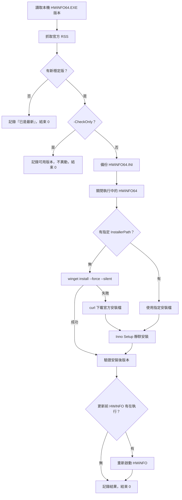

[](https://github.com/milochen0106/hwinfo-auto-update/actions/workflows/tests.yml)

# HWiNFO 自動更新工具（繁體中文導覽）

> 語言：[English](README.md) ｜ **繁體中文**

這是一套以 PowerShell 編寫的輕量工具：它會盯住 **HWiNFO 官方的穩定版發布通知**，一旦有新版本，就自動、靜默地完成更新，並保留你原有的設定。

不需要安裝任何 PowerShell 模組、外掛、agent 或背景服務。一台已經裝好 HWiNFO 的 Windows 10/11 電腦，加上管理者權限與網路，就足夠了。

---

## 導覽目錄

1. [為什麼需要這套工具](#1-為什麼需要這套工具)
2. [它會做什麼](#2-它會做什麼)
3. [快速開始（三分鐘上線）](#3-快速開始三分鐘上線)
4. [運作流程](#4-運作流程)
5. [需求與工具清單](#5-需求與工具清單)
6. [使用情境與指令](#6-使用情境與指令)
7. [參數對照表](#7-參數對照表)
8. [排程工作設定](#8-排程工作設定)
9. [檔案、日誌與備份](#9-檔案日誌與備份)
10. [疑難排解](#10-疑難排解)
11. [隱私與安全稽核](#11-隱私與安全稽核)
12. [設計限制](#12-設計限制)
13. [常見問答](#13-常見問答)
14. [授權與第三方聲明](#14-授權與第三方聲明)

---

## 1. 為什麼需要這套工具

HWiNFO 內建的「自動更新」功能是 **Pro 版專屬**。若你使用的是官方安裝檔裝上的免費版（非商業用途），要保持在最新版本只能自己上網查看、下載、執行安裝程式。

本工具把這件事自動化：

- 版本通知來源不是第三方猜測，而是 **HWiNFO 官方 RSS**（`https://www.hwinfo.com/news.xml/`）。
- 只認 **正式版**（`HWiNFO v8.60 released`），刻意忽略 Beta / RC / 預發布版本。
- 更新方式與系統管理員手動執行的一致：winget（比對套件 manifest 中記錄的 SHA-256）或直接執行官方 Inno Setup 安裝檔（先驗 PE 結構與Authenticode）。

---

## 2. 它會做什麼

| 步驟 | 行為 |
|---|---|
| 讀取本機版本 | 從 `HWiNFO64.EXE` 的 `ProductVersion` 取得，例如 `8.52-6060` → `8.52` |
| 尋找安裝路徑 | 先查 Windows 解除安裝登錄檔，再退回標準 Program Files 路徑；也可用 `-InstallDir` 指定 |
| 抓取官方通知 | 解析 RSS，篩掉 Beta / RC / pre-release，取最高穩定版 |
| 比對版本 | 官方版較新才動作；`-CheckOnly` 只回報不異動 |
| 備份設定 | 更新前將 `HWiNFO64.INI` 另存為時間戳檔名 |
| 關閉程式 | 先抓取執行中的 HWiNFO64 PID，逐一停止，再輪詢這些 PID 直到消失（最多 15 秒） |
| 執行更新 | 優先 winget（比對 manifest 記錄的 SHA-256）；失敗時改為 curl 下載官方安裝檔，先驗 PE 結構、Authenticode 簽章與精確發行者（`O=REALiX, s.r.o.`）再靜默安裝 |
| 驗證結果 | 重新讀取版本；未達目標版本即判定失敗 |
| 還原狀態 | 若更新前 HWiNFO 正在執行，**即使更新失敗**也會在 `finally` 中重新啟動 |
| 留下紀錄 | 每一步都寫入 `Update-HWiNFO.log` |

---

## 3. 快速開始（三分鐘上線）

### 步驟 1：取得程式

將本 repo 複製或下載到任何位置（例如 Downloads；這份複本只是**部署包**，排程工作不會指向它）：

```powershell
git clone https://github.com/milochen0106/hwinfo-auto-update.git C:\Scripts\hwinfo-auto-update
```

確認腳本與兩個 `lib` 檔案都在：

```powershell
Get-ChildItem .\Update-HWiNFO.ps1, .\Bootstrap-HWiNFO-AutoUpdate.ps1, .\lib\*.ps1
```

### 步驟 2：先只檢查（建議）

```powershell
powershell -NoProfile -ExecutionPolicy Bypass -File .\Update-HWiNFO.ps1 -CheckOnly
```

你會看到類似：

```text
2026-11-25 23:35:34 [INFO] Install directory: C:\Program Files\HWiNFO64
2026-11-25 23:35:34 [INFO] Installed version: 8.60
2026-11-25 23:35:34 [INFO] Latest stable version: 8.60 (source: https://www.hwinfo.com/news.xml/)
2026-11-25 23:35:35 [INFO] Already up to date.
```

### 步驟 3：一鍵安裝更新與排程

```powershell
powershell -NoProfile -ExecutionPolicy Bypass -File .\Bootstrap-HWiNFO-AutoUpdate.ps1
```

系統會彈出 UAC，請按「是」。提升後的腳本會：

1. 把腳本與 `lib` 複製到 ACL 硬化過的 `C:\ProgramData\HWiNFO-AutoUpdate\`，擁有者設為 `BUILTIN\Administrators`，只保留 `SYSTEM` 與系統管理員的完整控制權；
2. 以**部署後**的腳本立即執行一次更新檢查；
3. 註冊每日 09:00、以最高權限執行、指向部署後腳本的排程工作 `HWiNFO-AutoUpdate`。

之後手動操作也請用部署後的路徑：

```powershell
$deployed = Join-Path $env:ProgramData 'HWiNFO-AutoUpdate'
```

重複執行是安全的：註冊時使用 `-Force`，會覆蓋同名的舊工作。若要改排程，請執行部署後的 Bootstrap；從可寫入的 clone 再次執行會被刻意擋下，除非明確帶 `-ForceRedeploy`（代表你確定要用新版本覆蓋部署包）。

---

## 4. 運作流程



---

## 5. 需求與工具清單

### 不需要插件

兩支腳本只用 Windows PowerShell **內建 cmdlet**。沒有 PowerShell Gallery 套件、沒有 NuGet provider、沒有第三方模組、沒有 agent、沒有背景服務。指令本身帶 `-ExecutionPolicy Bypass`，所以對方即使預設為 `Restricted`，也不必改系統原則。

### 工具與條件對照

| 需求 | 是否 Windows 內建 | 用途 | 缺少時 |
|---|---|---|---|
| Windows 10 / 11（x64 或 ARM64） | 作業系統本身 | 全部功能 | 不支援；腳本以 `HWiNFO64.EXE` 為目標 |
| Windows PowerShell 5.1+（`powershell.exe`） | ✅ 內建 | 執行腳本 | 無法執行；PowerShell 7 可用但非必要 |
| .NET Framework | ✅ 內建 | XML 解析、TLS 1.2 | 隨 PowerShell 一併滿足 |
| **HWiNFO 64（官方 Inno 安裝）** | ❌ 需自行安裝 | 版本讀取、備份、更新 | 回報 `Cannot locate HWiNFO64.EXE`；可用 `-InstallDir` 指定 |
| 系統管理員權限 | ❌ 需 UAC 同意 | 寫入 Program Files、註冊最高權限排程 | `-CheckOnly` 仍可用；實際更新會失敗 |
| 可連到 `www.hwinfo.com` | ✅ 網路 | RSS、下載頁、安裝檔 | 無法取得版本資訊 |
| `winget`（App Installer） | 通常有（Win10 1809+ / Win11），但可能被移除 | **建議路徑**，比對套件 manifest 記錄的 SHA-256 | 非必要：自動改走直接下載 |
| `curl.exe` | ✅ Win10 1809+ / Win11 內建 | 快速備援下載 | 非必要：改走 `Invoke-WebRequest`，但官方 CDN 可能回 403 |
| 工作排程器 | ✅ 內建 | 每日自動執行 | 僅自動化不可用，手動執行仍可 |

**簡單說**：一般 Windows 11 電腦，你只需要準備 HWiNFO 本身、更新時按一下 UAC、以及網路。其他東西都已經在系統裡。

---

## 6. 使用情境與指令

以下指令需要先設定部署路徑：

```powershell
$deployed = Join-Path $env:ProgramData 'HWiNFO-AutoUpdate'
```

| 情境 | 指令 |
|---|---|
| 只檢查、不安裝 | `powershell -NoProfile -ExecutionPolicy Bypass -File "$deployed\Update-HWiNFO.ps1" -CheckOnly` |
| 立即更新到最新版 | `powershell -NoProfile -ExecutionPolicy Bypass -File "$deployed\Update-HWiNFO.ps1"` |
| 強制重裝同版本（修復） | `powershell -NoProfile -ExecutionPolicy Bypass -File "$deployed\Update-HWiNFO.ps1" -Force` |
| 用手動下載好的安裝檔 | `powershell -NoProfile -ExecutionPolicy Bypass -File "$deployed\Update-HWiNFO.ps1" -InstallerPath 'C:\Temp\hwi64_860.exe'` |
| 更新後不要自動開 HWiNFO | 加上 `-NoRestore` |
| 改排程時間為 18:30 | `powershell -NoProfile -ExecutionPolicy Bypass -Command "& \"$deployed\Bootstrap-HWiNFO-AutoUpdate.ps1\" -TaskTime '18:30'"` |

`-InstallerPath` 仍會先讀 RSS：只有真的需要更新（或給了 `-Force`）才會用到你提供的安裝檔。該檔案會先被複製到受保護的 `Downloads\` 目錄才驗證與執行，不會直接使用原始可寫入路徑。

---

## 7. 參數對照表

### `Update-HWiNFO.ps1`

| 參數 | 型別 | 預設 | 說明 |
|---|---|---|---|
| `-CheckOnly` | switch | 關 | 只比對版本，不下載、不安裝 |
| `-Force` | switch | 關 | 版本已相同時仍重裝（修復用）。**不會**降版 |
| `-AllowDowngrade` | switch | 關 | 明確允許安裝比目前更舊的版本；未指定時本機版本較新就跳過 |
| `-NoRestore` | switch | 關 | 更新後不重新啟動 HWiNFO |
| `-InstallerPath` | string | 無 | 使用預先下載的安裝檔；先複製到受保護 `Downloads\` 再驗簽章 |
| `-InstallDir` | string | 自動偵測 | 覆寫 HWiNFO 安裝目錄 |
| `-AllowUnprotectedRun` | switch | 關 | 僅供開發／測試：放寬「必須從受保護目錄執行」的限制 |
| `-LogPath` | string | `<腳本目錄>\Update-HWiNFO.log` | 日誌位置 |

### `Bootstrap-HWiNFO-AutoUpdate.ps1`

| 參數 | 型別 | 預設 | 說明 |
|---|---|---|---|
| `-TaskName` | string | `HWiNFO-AutoUpdate` | 排程工作名稱 |
| `-TaskTime` | string | `09:00` | 每日執行時間（`HH:mm`） |
| `-InstallerPath` | string | 無 | 轉傳給 `Update-HWiNFO.ps1` |
| `-StalePids` | int[] | 無 | 更新前先終止的舊行程 PID；只處理 `powershell`／`pwsh`，且解析出的 `-File` 參數精確等於本專案腳本路徑者 |
| `-DeployRoot` | string | `%ProgramData%\HWiNFO-AutoUpdate` | 部署目錄；日誌、備份與暫存安裝檔都在這裡，路徑不可改 |
| `-ForceRedeploy` | switch | 關 | 已有受保護部署時，仍允許從可寫入的 clone 重新部署；僅在刻意更新部署包時使用 |

> 從 `powershell -Command` 傳陣列請用 `-StalePids @(1234,5678)`；寫成 `-StalePids 1234,5678` 會被當成單一字串。
> `-TaskName` 不得含 `\ / : * ? " < > |`，`-TaskTime` 必須是 24 小時制 `HH:mm`；兩者都在提權**前**驗證，打錯不會留下半套設定。
> `-StalePids` 是修復用參數，不是例行開關：請只傳入剛剛觀察到、來源可信的 PID。在身分檢查與實際終止之間仍有極小的 TOCTOU 時窗，Windows 可能在此期間重用 PID；檢查能大幅降低風險，但無法完全消除。

---

## 8. 排程工作設定

由 Bootstrap 建立，屬性如下：

| 屬性 | 值 |
|---|---|
| 名稱 | `HWiNFO-AutoUpdate` |
| 觸發 | 每日 09:00（可用 `-TaskTime` 改） |
| 執行權限 | Highest privileges |
| 帳號 | 目前使用者，interactive logon |
| 動作 | `<SystemRoot>\System32\WindowsPowerShell\v1.0\powershell.exe -NoProfile -ExecutionPolicy Bypass -NonInteractive -WindowStyle Hidden -File "%ProgramData%\HWiNFO-AutoUpdate\Update-HWiNFO.ps1"` |
| 工作目錄 | `%ProgramData%\HWiNFO-AutoUpdate` |
| 錯過時補跑 | 是（`StartWhenAvailable`） |
| 重複執行個體 | `IgnoreNew` |
| 逾時 | 15 分鐘 |

查看與移除：

```powershell
Get-ScheduledTask -TaskName 'HWiNFO-AutoUpdate' | Format-List
Unregister-ScheduledTask -TaskName 'HWiNFO-AutoUpdate' -Confirm:$false
```

---

## 9. 檔案、日誌與備份

| 項目 | 位置 | 用途 |
|---|---|---|
| `Update-HWiNFO.ps1` | repo 根目錄 | 版本檢查與更新主程式 |
| `Bootstrap-HWiNFO-AutoUpdate.ps1` | repo 根目錄 | 提升權限與註冊排程 |
| `lib/HWiNFO.Core.ps1` | `lib/` | 純函式（版本解析、RSS 解析、PE 檢查、簽章檢查、參數驗證、受保護路徑檢查），由兩支腳本與測試共用 |
| `lib/HWiNFO.Deploy.ps1` | `lib/` | ACL 硬化與受保護部署函式，僅由 Bootstrap 載入 |
| `tests/HWiNFO.Core.Tests.ps1` | `tests/` | Pester 測試；不連網、不安裝 |
| `tests/HWiNFO.Deploy.Tests.ps1` | `tests/` | Pester 部署／ACL 測試；mock `icacls`，不真的改 ACL |
| `tests/Update-HWiNFO.Workflow.Tests.ps1` | `tests/` | Pester 整合測試；以 mock 模擬所有外部效應 |
| `.github/workflows/tests.yml` | `.github/` | CI：在 `windows-latest` 跑 Pester 與 PSScriptAnalyzer |
| `%ProgramData%\HWiNFO-AutoUpdate\` | 受保護 | 部署後的腳本、日誌、暫存安裝檔與 INI 備份。擁有者 `BUILTIN\Administrators`，僅 `SYSTEM` 與系統管理員可存取 |
| `%ProgramData%\HWiNFO-AutoUpdate\Downloads\` | 受保護 | 下載或使用者提供的安裝檔，驗證前先放在這裡 |
| `%ProgramData%\HWiNFO-AutoUpdate\HWiNFO-Backups\` | 受保護 | 時間戳記的 `HWiNFO64.INI` 備份 |

Bootstrap 在提權前仍會在 clone 旁邊寫一份安裝紀錄，以備程序還沒走到 ProgramData 就失敗。

日誌格式：

```text
yyyy-MM-dd HH:mm:ss [LEVEL] message
```

層級分為 `INFO`、`WARN`、`ERROR`。備份檔名格式為 `HWiNFO64.<yyyyMMdd-HHmmss>.INI`。腳本**不會**自動刪除備份，請依你的留存政策自行清理。

### 結束代碼

| 代碼 | 意義 |
|---|---|
| `0` | 已是最新、dry-run 完成，或更新後驗證成功 |
| `1` | 失敗：無法取得版本通知、找不到安裝目錄、下載／安裝失敗、更新後驗證失敗 |

Bootstrap 會轉回更新程式的結束碼；參數驗證失敗或排程註冊失敗時另外回 `1`。未提權的父行程會等待提權後的子行程並轉回其結束碼；只有在 Windows 不允許跨完整性層級等待時才會回 `0`，此時請看 `Bootstrap-HWiNFO-AutoUpdate.log` 的最終結果。

工作排程器在首次執行前顯示 `0x41303`（`267011`，「工作尚未執行」）是正常現象。

### 測試與 CI

```powershell
# 需要 Pester 5 以上（Windows 內建的 3.4 不支援）
Install-Module Pester -MinimumVersion 5.5.0 -Force -Scope CurrentUser
Invoke-Pester -Path ./tests -Output Detailed
```

測試不連網、不安裝 HWiNFO、不真的改 ACL，也不需要系統管理員權限。純函式測試使用 XML fixture 與 Windows 內建的簽章檔案；部署測試 mock `icacls` 與 `takeown` 並把 `ProgramData` 導向暫時目錄；整合測試把 `Update-HWiNFO.ps1` 以 dot-source 搭配 `-AllowUnprotectedRun` 指向暫時安裝目錄，並 mock 掉 winget、下載、安裝結束碼與運行中行程，涵蓋 winget 成功／失敗、備援下載、winget 成功但版本未變、驗證失敗、更新失敗時是否依 `-NoRestore` 重啟 HWiNFO，以及使用者提供安裝檔會先暫存到 `Downloads\`。CI（`.github/workflows/tests.yml`）在每次 push 與 PR 執行同一套測試、以 error 等級跑 PSScriptAnalyzer，並用 Windows PowerShell 5.1 解析所有 `.ps1`。文件頂端的 badge 指向 `main` 最近一次執行結果，個別紀錄在 Actions 分頁。

目前沒有會真正執行升級或觸發 UAC 提權的自動化測試；那些路徑仍以 `-CheckOnly` 加人工檢視日誌驗證。

---

## 10. 疑難排解

| 現象 | 原因 | 處理方式 |
|---|---|---|
| `Cannot locate HWiNFO64.EXE` | 非標準安裝路徑或可攜版 | 加 `-InstallDir "D:\Tools\HWiNFO64"` |
| 官方 CDN 對 `Invoke-WebRequest` 回 `403` | 該用戶端被 CDN 擋下 | 腳本已優先用 `curl.exe` + 瀏覽器 UA；請保留 `curl.exe` |
| winget 下載卡住幾分鐘 | winget manifest 指向較慢的鏡像（`sac.sk`） | 等待，或改用手動下載的安裝檔 + `-InstallerPath` |
| UAC 被取消／逾時 | 提升行程根本沒啟動，未做任何異動 | 重跑 Bootstrap 並按「是」 |
| `Failed to deploy protected copy: icacls ... /setowner ... exit code 5` | 舊版（1.3.0）用 `icacls` 設群組 owner，Windows 即使提權仍拒絕 | 升級到 1.3.1+；改用 `takeown /A` 設 owner |
| `Access denied`（`Wait-Process`／`Stop-Process`） | 非提升行程不能控制提升行程 | 從提升後的 Bootstrap 用 `-StalePids` 清理 |
| `Refusing to run from an unprotected location: ...` | 直接從 Downloads／repo clone 執行 `Update-HWiNFO.ps1` | 改執行 `%ProgramData%\HWiNFO-AutoUpdate\Update-HWiNFO.ps1`；開發或測試才用 `-AllowUnprotectedRun` |
| `A protected deployment already exists ...` | 從可寫入的 clone 重跑 Bootstrap | 改從 `%ProgramData%\HWiNFO-AutoUpdate\Bootstrap-HWiNFO-AutoUpdate.ps1` 執行；確定要覆蓋部署包才加 `-ForceRedeploy` |
| 出現 Beta 但沒安裝 | 設計如此，Beta／RC 被篩掉 | 等正式版；若確定要預發布，需修改 `Get-LatestStableVersion` |
| HWiNFO 短暫消失 | 更新前會關閉它，完成後再開 | 不希望自動開就用 `-NoRestore` |
| `Unexpected publisher '...'` 或 `Authenticode signature is not valid` | 安裝檔不是 `REALiX, s.r.o.` 簽章（代理頁面、鏡像 HTML、被竄改） | 重新從 `https://www.hwinfo.com/download/` 下載；不要繞過檢查 |
| `Refusing to stop PID=...` | 該 PID 已被 Windows 重用，現在屬於別的程式 | 什麼都沒被終止，可忽略；下次用 `-StalePids` 前先確認 PID |
| Bootstrap 回 `0` 但什麼都沒發生 | Windows 擋住跨完整性層級的等待 | 看 `Bootstrap-HWiNFO-AutoUpdate.log` 的最終結果 |
| 首次排程顯示 `267011` | 尚未到執行時間 | 無須處理 |

---

## 11. 隱私與安全稽核

公開版本已做過以下檢查與處理：

- **檔案內容**：無個人 email、本機帳號路徑、token、API key 或密碼；`README.md` 中的 `C:\Users\<you>` 是佔位符，不是實際路徑。
- **Git commit metadata**：已全面改用 `milochen0106@users.noreply.github.com`，不再暴露個人 Gmail。
- **來源限制**：版本資訊只取自官方 RSS；安裝檔只來自官方下載頁或 winget manifest。
- **雜湊驗證**：winget 路徑比對的是**套件 manifest 中記錄的 SHA-256**，不是另外由 REALiX 發布的雜湊值，因此不把它當成「發行者提供」。直接下載路徑在執行前做三項檢查：(1) PE 結構檢查（`MZ`、`e_lfanew` 處的 PE 簽章、機器類型非零、至少一個 section、PE32/PE32+ optional header）——這只是「外形」檢查，不能用來證明檔案完整；(2) Authenticode 簽章狀態為 `Valid`；(3) 以可處理引號的解析器取出憑證**組織欄位 `O`，並要求精確等於 `REALiX, s.r.o.`**。只含「REALiX」字樣或由其他發行者簽出的有效憑證都會被拒絕。比對的是法律實體而非憑證指紋，因此同一發行者換發新憑證仍可通過。
- **`-InstallerPath` 同樣驗證**：你提供的安裝檔會先複製到受保護的 `Downloads\`，再對該副本做上述三項檢查；原始可寫入路徑被掉包或損毀都不會被執行。
- **下載備援**：先寫入 `.part` 暫存檔，超過 10 MB 才會改名為正式檔；curl 失敗時先清掉不完整檔案，再試 `Invoke-WebRequest`。上次留下的截斷檔不會被當成成功下載。
- **PID 誤殺防護**：`-StalePids` 只接受 `powershell`／`pwsh`，且從命令列解析出的 `-File` 參數精確等於本專案腳本路徑的行程；只是把路徑寫在 `-Command` 或其他參數中不算。Windows 會重用 PID，單靠 ID 不足以證明身分；在檢查與終止之間仍有極小的 TOCTOU 時窗，因此請只傳入剛觀察到、來源可信的 PID。
- **無憑證儲存**：腳本不保存任何憑證、token 或個人化設定，只讀取公開 HTTPS 端點與本機安裝資訊。
- **權限透明**：提升權限由 Bootstrap 明確觸發 UAC；在新的電腦上請先審視腳本再按「是」。
- **提權邊界（1.3.0+）**：Bootstrap 會把腳本與 `lib` 部署到 `C:\ProgramData\HWiNFO-AutoUpdate\`，移除繼承的 ACL、把擁有者改成 `BUILTIN\Administrators`，只授權 `SYSTEM` 與系統管理員完整控制。排程工作執行的是部署後的腳本，不是 clone。`Update-HWiNFO.ps1` 拒絕從使用者可寫入目錄執行（除非明確給 `-AllowUnprotectedRun`）；部署目錄若是 reparse point 會被拒絕；從可寫入 clone 再次部署會被擋下，除非給 `-ForceRedeploy`。這切斷了「任何同使用者程序改寫 Downloads／Desktop 裡的腳本 → 09:00 以管理員執行」的路徑。
  - 改擁有者是必要的：若擁有者仍是個別管理員帳號，該帳號的一般 token 仍隱含 `WRITE_DAC`，可以把自己寫回去。
  - 剩餘風險：排程工作新建的檔案（日誌、備份、暫存安裝檔）在 Windows 預設下以建立者為擁有者；同一帳號的一般行程仍可能改這些檔案的 DACL。腳本與 `lib` 不受影響（部署時已硬化，排程工作不會重建它們）；暫存安裝檔在驗證與執行之間仍有殘留 TOCTOU，此風險不跨帳號邊界。詳見 `SECURITY.md`。

> 這套檢查**無法**防禦：官方 RSS 被入侵，或官方簽章程式碼簽章憑證被竊。因為信任錨點就是官方本身，RSS 被改寫或官方簽出的惡意安裝檔都會通過驗證。PE 結構檢查也無法證明檔案在簽章後沒被動過，完整性是由 Authenticode 負責。它也無法防禦操作者刻意用 `-ForceRedeploy` 部署被竄改的套件，那就等於自己以管理員執行不受信任的程式。

> 補充說明：force push 已把舊 commit 從分支歷史移除，但 GitHub 短期內仍可能透過舊 SHA 直接存取該物件；若要求澈底清除，需向 GitHub Support 提出請求。

---

## 12. 設計限制

- 僅 Windows；HWiNFO 32 與 DOS 版不在範圍內。
- 只處理正式版，預發布版本刻意排除。
- 實際更新與註冊最高權限排程都需要系統管理員權限。
- 官方 HWiNFO 安裝檔在靜默安裝後仍可能自行啟動一次 HWiNFO；本工具不干涉這個內建行為。
- 版本比對只用 `major.minor`（例如 `8.60`），不使用 build number（例如 `6120`）；這與官方公開發布編號一致。
- 若官方改變 RSS 標題格式或安裝檔網址命名規則，需調整 `Get-LatestStableVersion` 或 `Get-InstallerUrl`。

---

## 13. 常見問答

**Q：它會安裝 Beta 嗎？**
不會。RSS 中的 Beta / RC 公告會被排除，這是刻意設計，避免不穩定版本進到正式環境。

**Q：執行時會不會覆蓋我的 HWiNFO 設定？**
更新前會先備份 `HWiNFO64.INI`；官方 Inno 安裝在升級時會保留既有設定。即使發生異常，你仍有時間戳備份可還原。

**Q：公司環境可以用嗎？**
HWiNFO 64 免費版僅供非商業使用。商業用途需依[官方授權](https://www.hwinfo.com/licenses/)升級 Pro；本工具只負責更新，不處理授權。

**Q：可以完全離線更新嗎？**
不行。版本通知必須連到官方 RSS，安裝檔也必須從官方來源取得。但你可以先手動下載安裝檔，再用 `-InstallerPath` 離線更新（版本檢查仍會失敗，需搭配 `-Force`）。

**Q：要怎麼確認腳本沒有亂改東西？**
先看 `-CheckOnly` 輸出，再查 `Update-HWiNFO.log`；每次更新都有版本、備份路徑、安裝檔 SHA-256 與結束碼可追溯。

---

## 14. 授權與第三方聲明

本 repo 的腳本以 [MIT License](LICENSE) 釋出。

HWiNFO® 為 Martin Malík / REALiX, s.r.o. 的註冊商標。本專案為獨立工具，**與 REALiX 無任何關聯、背書或贊助關係**。HWiNFO 軟體本身仍適用其[官方授權條款](https://www.hwinfo.com/licenses/)。

變更紀錄請見 [CHANGELOG.md](CHANGELOG.md)；漏洞回報政策請見 [SECURITY.md](SECURITY.md)。
